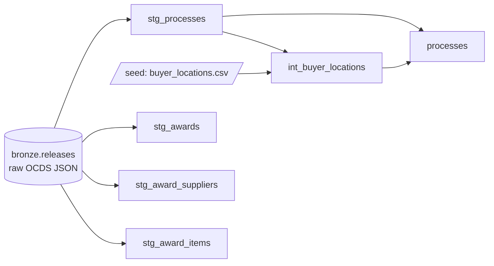

# Data model

Lupa Pública follows a medallion layout in one DuckDB file (`data/lupa.duckdb`):

- **bronze**: SERCOP releases exactly as received (raw JSON). Private, never published.
- **silver**: typed, cleaned tables built with dbt. No interpretation and no risk logic.
- **gold** (Phase 5): risk indicators and aggregates for the public site.

## Silver tables

| Table | One row per | Key | Main columns |
|---|---|---|---|
| `processes` | contracting process | `ocid` | buyer, buyer province/canton (+ `buyer_location_source`), procurement method, tender amount, number of tenderers, tender period, award and contract counts |
| `stg_awards` | award | `ocid` + `award_id` | status, date, awarded amount, supplier count |
| `stg_award_suppliers` | supplier of an award | — | supplier type, `supplier_key`, supplier name (companies and public entities only) |
| `stg_award_items` | item of an award | `ocid` + `award_id` + `item_index` | CPC code, quantity, unit, unit price, line amount |
| `int_buyer_locations` | buyer | `buyer_id` | province and canton inferred for buyers that publish no address |

## Rules applied everywhere

- **Amounts of 0 mean "unknown"**, not free: they become `NULL` (tender, award, unit price).
- **Each release is parsed once** with `from_json` and a minimal schema (ADR-0003). Extracting fields one by one ran out of memory.
- **Data minimization:** contact points, addresses of suppliers, item descriptions and tenderer identities are never loaded. Tenderers are only counted.
- **Privacy (ADR-0004):** natural persons are identified only by an HMAC pseudonym (`supplier_key`) and never by name or cédula. Unclassifiable ids are treated as personal. A dbt test enforces this on every build.
- **Lineage:** derived values say where they come from (e.g. `buyer_location_source` = `published`, `same_buyer` or `manual`; the manual seed requires an `evidence` column).

## Quality checks

- 41 dbt checks: keys unique and not null, accepted values (procurement methods, 24 provinces, supplier types), positive amounts, and the privacy test. Quantities ≤ 0 only raise a warning (a SERCOP data issue, not a model bug).
- CI builds every model on a synthetic fixture (`tests/fixtures/`) on every pull request.

## Known limits

- `selective` is mostly electronic catalogue purchases: they have no tenderers or tender period.
- Tender period dates exist for about 24% of open procedures; award dates for about 17% of awards.
- Contracts have no amendments, so contract increases cannot be measured.
- The buyer's province is where the buying entity is registered, not necessarily where the money is spent.
